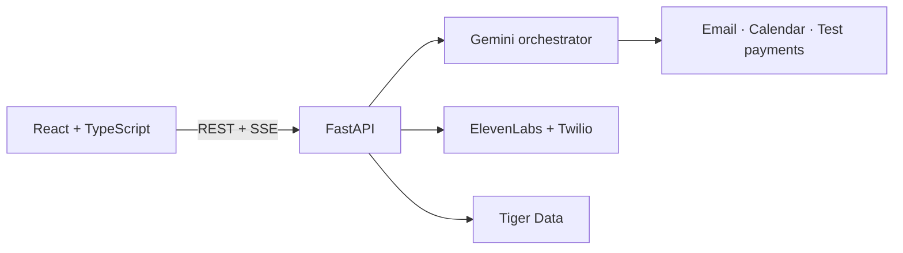

# Concierge · OxHack 26

An agent workspace for the everyday things you'd rather delegate. Choose an agent, grant its tool permissions, send it a task, follow its call, approve a deposit, and find confirmed plans in your calendar.

## Frontend MVP

Built with **Vite, React, TypeScript, Tailwind CSS, React Router, and TanStack Query**. Requires Node.js 22.12+ (or 24+) and npm.

```sh
cd frontend
npm ci
cp .env.example .env.local
npm run dev
```

Open the local URL printed by Vite. Demo mode is enabled by default and needs no backend or credentials. All demo calls, emails, bookings, and payments are simulated; state is saved in this browser. It does not place calls or spend money.

### Try the demo

1. Choose Maya with the arrow buttons, check the tools you want to allow, and select **Enter agent**. Permissions are saved per agent. You can also create a new agent.
2. Choose **Book a table**, then send the message.
3. Watch the simulated call and transcript. A £20 test deposit approval appears after about six seconds.
4. Approve to complete the booking, or decline to stop it without a reservation.
5. Visit **Calendar**, export the `.ics` file, then view **Analytics**.
6. Send `no answer` to see a failed task and retry by sending a new message.

The fixture deliberately demonstrates one dinner booking at The Ivy Oxford tomorrow at 18:00, regardless of the request text. Agents without phone tools complete a simple simulated organisation task. Agents without payments cannot confirm the restaurant's deposit. Calendar and email actions respect their tool toggles. Clear this site's browser storage to reset the demo.

### Checks

```sh
npm run build
npm test
npx playwright install chromium
npm run test:e2e
```

Browser tests cover desktop and mobile: agent selection, saved permissions, text contrast, the full booking flow, approval and decline, calendar download, analytics, and failure recovery.

## Connect the backend

Set `VITE_DEMO_MODE=false` in `frontend/.env.local`, then restart Vite. `/api` is proxied to `http://localhost:8000` during development. Alternatively set `VITE_API_BASE_URL` to your backend URL (it must allow the frontend origin with CORS). Production settings are baked into the build; see [frontend/README.md](frontend/README.md).

The backend has not landed yet. The typed adapter follows the sketch in [docs/DESIGN.md](docs/DESIGN.md), with explicit provisional response contracts documented in [frontend/README.md](frontend/README.md). Run `npm run api:generate` once FastAPI exposes `/openapi.json`, then align the adapter with Alex's authoritative schema. The current types are handwritten, not generated. Live mode never silently falls back to simulated results.



[System design](docs/DESIGN.md) · [Team plan](docs/PLAN.md)

Real service integration, production rehearsal, screenshots/video, and public submission are pending the backend and deployment. No production or sponsor integration is claimed by the local demo.
