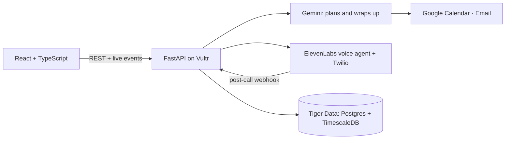

# Smart Connect · OxHack 26

Tell an AI agent what you need, and it phones the business for you, books a time that works, and reports back with the transcript and the result.

Live: https://192-248-148-174.sslip.io

## What it does

1. **Create an agent.** Give it a name and choose what it may do: phone calls, email, calendar and (test) payments.
2. **Ask in plain English.** For example: "Book a table for 4 at The Ivy tomorrow at 6pm, 7pm is fine too."
3. **It plans the call.** Gemini works out who to call, what to ask for, and which alternatives you said are fine.
4. **It makes a real phone call.** An ElevenLabs voice agent rings the business over Twilio and talks to whoever answers. It sticks to your times, offers your alternatives, and says it's an AI if asked. The chat shows the call live, from dialling and ringing to answered, with a timer and a Hang up button.
5. **You get the result.** When the call ends you see the full transcript, a short summary, and a result table (business, date, time, details). If it's booked and the agent has those permissions, it adds the event to your Google Calendar and emails you a confirmation.

If the time isn't available, the agent can call back once with a time the business offered, as long as it's one you allowed.

## How it's built



- **Gemini API:** the orchestrator. It turns your message into a call brief (business, goal, constraints, allowed alternatives) using function calling. After the call, it reads the transcript, extracts a structured result, decides whether to call back, adds the calendar event, sends the email and writes your summary.
- **ElevenLabs:** the voice agent that actually holds the phone conversation, placed through ElevenLabs' Twilio integration. The full transcript arrives through a signed post-call webhook. A server tool lets the agent ask you to approve a deposit mid-call.
- **Tiger Data:** the database (Postgres + TimescaleDB). Every call is a time-series of events (dialling, ringing, answered, each transcript line, ended) in a `call_events` hypertable. The chat streams the live call view from that table over server-sent events.
- **Vultr:** a London VM runs the FastAPI app (systemd) behind Caddy, which serves the built frontend and HTTPS.

**Stack:** FastAPI (Python, async psycopg), React + TypeScript + Vite, TanStack Query.

For the demo, every call rings one fixed test number (`CALL_NUMBER`), whatever business you name, so no real business is ever called.

## Run it locally

**Frontend only (demo mode).** This simulates calls, so it needs no backend or keys:

```sh
cd frontend
npm ci
cp .env.example .env.local
npm run dev
```

**Full app:**

1. Copy `.env.example` to `.env` in the repo root and fill in the keys: Gemini, Tiger `DATABASE_URL`, ElevenLabs, Twilio, `CALL_NUMBER`, and optionally Google Calendar and Resend.
2. Install and start the backend:

```sh
cd backend
python3 -m venv .venv && .venv/bin/pip install -r requirements.txt
.venv/bin/python -m scripts.migrate
.venv/bin/python -m uvicorn app.main:app --port 8000
```

3. Run the frontend with `VITE_DEMO_MODE=false` in `frontend/.env.local`. During development, `/api` is proxied to port 8000.

**Tests:** run `.venv/bin/python -m pytest` in `backend`, and `npm test && npm run build` in `frontend`.

## Team

Jamil and Alex (plus Evan, who built the first frontend). See the [system design](docs/DESIGN.md).
